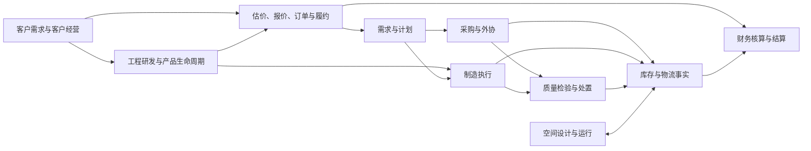

# CP6

**CP6 面向通用制造业，目标是建设一套覆盖客户经营、工程研发、供应链、生产执行与财务协同的企业管理平台。** 项目以完整业务需求为起点，将客户需求、商业承诺、产品与工程版本、计划采购、制造质量、库存物流及财务核算连成可追溯的端到端业务链，并通过多租户与公共平台能力支持不同企业落地。

产品采用**通用核心与有明确适用范围的行业扩展**：产品、物料、BOM、工艺、订单、计划、工单、投入产出、库存、质量和财务构成共同核心；材料、包装、计量、几何、节拍与成本规则按具体制造场景配置。已有纸品、油墨、版模等专项能力保留其适用范围，纸层、克重、印刷、箱数等字段只在对应场景中要求。现有逻辑在正确且适用时复用，设计以业务需求和完整性为依据。

截至 **2026-10-25**，项目按 **CRM / ERP / ENG / PLM / PLAN / PUR / MES / QA / WMS / FIN / OA / SYS / Platform / Space** 的整体范围持续建设。本仓承载制造业务主应用、Vue Web、Windows WPF、Android MAUI 与 Space，并与独立 CRM、Platform 仓库协作。产品范围与领域职责见 [系统边界与开发地图](docs/design-handbook/architecture/01-系统边界与开发地图.md)。

> 本页同时介绍产品目标、已有实现与当前进展。完整目标、任务状态与业务验收以 [开发台账](docs/development/roadmap.json) 为准；通用制造方向不表示所有行业、生产方式或专项规则均已实现和验证。

## 最近进展

- **PostgreSQL 成为后续开发唯一数据库目标。** 已有独立持久化项目、四个 Context 的迁移链，以及限定身份/消息场景的租户连接、角色隔离和事务接线。保留既有 SQL Server 实现与历史证据，现有数据迁移和环境切换另行执行。见 [数据库基线](docs/development/08-postgresql-baseline.md)。
- **身份权限与业务写入持续接通。** 当前组织、角色、数据范围与字段权限已用于多条真实业务路径；关键写入在提交前复核权限，并保留并发、回滚和原请求恢复语义。最新设备创建支持明确部门归属及原操作结果恢复，见 [设备创建交付](docs/development/evidence/W136-01/DELIVERY.md)。
- **库存调整、移库和流水归属完善。** 调整/MOVE 页面支持按原操作查询与恢复；新流水从本次实际修改的库存对象继承可信部门，覆盖移库两腿、盘点、收货、出库、MES 反冲及订单取消。历史流水不按业务键推断归属。见 [库存流水交付](docs/development/evidence/W137-01/DELIVERY.md)。
- **CRM 询盘主线已有跨仓实现。** Main 提供当前身份与用途权限来源；独立 CRM 已交付配置预览/激活、公开提交、人工处理、同意撤回、到期保留处理和原生事件发布/恢复的限定能力。真实企业政策、日历、身份登记和消息链路仍待验证，见 [当前采用边界](docs/development/evidence/W135-01/DELIVERY.md)。
- **Platform 公共包已采用 0.10.3。** Main 使用正式签名包提供 ASP.NET Core、EF 和消息基础能力；各业务 Owner 的采用、真实消息消费者及环境资格按任务分别验收，见 [Main 包采用记录](docs/development/evidence/WP02-02/main-package-adoption/DELIVERY.md)。

当前重点仍包括其余新对象的可信归属、补货/退货的完整写入接缝、计划写入共同事务、真实宿主与企业消息链路，以及最终集成。完整范围见 [开发进度](docs/development/03-progress.md) 与 [当前任务入口](docs/development/09-parallel-development.md)。

## 产品范围与业务主线

当前设计覆盖 125 个目标，开发按 14 个工作包推进。下表区分产品职责与已有实现；具体采用情况见 [工作包](docs/development/01-work-packages.md) 和 [模块设计目录](docs/design-handbook/模块目录.md)。

| 领域 | 产品职责 | 当前建设情况 |
| --- | --- | --- |
| CRM / 客户经营 | 询盘、线索、客户、联系人、商机与销售活动 | 独立 CRM 已交付询盘配置、受理、人工处理等限定能力；完整客户经营链持续建设 |
| ERP / 商业交易 | 商业主数据、估价、价格、报价、订单、信用与履约 | 已有销售业务实现；通用材料估算及新的商业交接合同按目标逐项采用 |
| ENG / 工程管理 | 产品技术身份、修订与基线、BOM、工艺及工具技术定义 | 已形成设计；现有工程相关实现需按新身份、版本与采用边界整合 |
| PLM / 产品生命周期 | 需求、工程活动、受控文档、验证、变更、偏差、发布、反馈与生命周期 | 已有设计和候选资产，完整生命周期与工程发布能力仍待实现、整合和验收 |
| PLAN / 计划管理 | 需求、计划策略、MRP、供需建议及承诺计算 | 已有 MRP 和采购申请接缝；完整计划写入协议持续建设 |
| PUR / 采购管理 | PR、RFQ、PO、供应商价格、收货、匹配、退货与外协 | 已有采购闭环实现；继续对齐物理收发与财务义务的跨域合同 |
| MES / 制造执行 | 工单、排程、领退料、执行、消耗、报工与产出 | 已有制造执行、设备、OEE 与排程页面；继续接通工程基线及可信业务归属 |
| QA / 质量管理 | 检验规则、检验结果、不合格及处置 | 已有品质/检验实现及独立入口；质量决定与库存、财务实际应用按合同衔接 |
| WMS / 仓储物流 | 库存、预留、收发、移库、盘点、补货、标识、追溯与仓储控制 | 已有广泛业务实现和原生客户端；新写入、归属及恢复协议逐步采用，保留有适用边界的卷材、余料、油墨等专项 |
| FIN / 财务管理 | 总账、应收应付、资金、发票、成本、资产、预算与结账 | 已有核算及报表实现；按真实商业义务与库存事实继续完善集成 |
| OA / 工作流 | 表单、流程、任务、审批绑定、连接器与工作台 | 已有流程引擎及页面；审批决定、业务应用和结果回执按新合同整合 |
| SYS / Platform | 身份、组织、权限、多租户、隐私、审计、可靠消息与可观测性 | 已有公共能力、正式包与多条真实业务接线；限定采用范围分别验证 |
| Space / 空间数字底座 | 空间、资产、2D/3D 设计、发布、运行态、调度与仿真 | 已有独立分层、CAD/Excel 导入、运行叠加和规划能力；空间设计与业务采用分别确认 |

产品围绕以下业务关系展开，图中连线表示目标职责与协作关系；实现和验收进度按台账分别记录：



OA、身份权限、多租户与 Platform 为各业务链提供协作和公共能力。每个业务领域负责自己的事实与结果；审批通过、消息送达、库存生效和财务过账分别记录，保证业务过程可追溯、失败后可恢复。

## 技术栈与仓库边界

| 层 | 当前技术 |
| --- | --- |
| 后端 | ASP.NET Core 8、EF Core 8、Dapper、JWT / OpenID Connect、SignalR |
| 数据库 | PostgreSQL（后续开发与本地验收目标）、Npgsql、独立迁移程序集；既有 SQL Server 路径保留历史兼容范围 |
| Web 前端 | Vue 3.5、TypeScript 6、Vite 8、Element Plus、Pinia、Vue Router、vue-i18n |
| 空间与可视化 | Three.js、Konva、Vue Flow、PDF.js、Open XML |
| 基础设施与集成 | Redis、RabbitMQ、Kafka、S3 兼容对象存储、Prometheus；具体启用项由宿主配置与任务范围决定 |
| 公共包 | CP6.Platform 0.10.3，按 NuGet 来源映射、签名信任及锁文件恢复 |
| 原生客户端 | .NET 8 WPF、.NET 10 MAUI Android、CP6.Client.Api / CP6.Client.Core |
| 本地验证 | xUnit、PostgreSQL 定向集成、Vitest、Playwright、OpenAPI / 客户端契约检查 |

| 仓库 | 责任 |
| --- | --- |
| [CP6](https://github.com/GTX537/CP6) | 制造业务主应用、Main 身份与 ERP Owner、Vue 管理端、Space、原生 WMS 客户端和开发总台账 |
| [CP6.CRM](https://github.com/GTX537/CP6.CRM) | 独立 CRM 应用、询盘 Owner、API/BFF 与页面；访问需相应仓库权限 |
| [CP6.Platform](https://github.com/GTX537/CP6.Platform) | 共享合同、消息与持久化基础包及正式包交付 |
| [CP6.AI-Handoff](https://github.com/GTX537/CP6.AI-Handoff) | 跨对话通信、固定提交交接与证据定位；业务状态仍以 Main 台账为准 |

主应用结构仍为 `CP6.WebApi → CP6.Core → CP6.Entity`。Space 使用独立分层后由 WebApi 组合；PostgreSQL 迁移位于独立项目。Web、WPF 和 Android 通过 HTTP / SignalR 访问主应用。

```text
CP6.Entity/                  共享实体、DTO 与业务数据模型
CP6.Core/                    业务服务、权限、工作流、EF 与跨域基础设施
CP6.Persistence.PostgreSql/  PostgreSQL 独立迁移程序集
CP6.WebApi/                  REST API、身份入口、SignalR、后台任务与种子
CP6.Tests/                   主应用单元、集成、安全与回归测试

CP6.Space.Domain/            Space 领域模型
CP6.Space.Contracts/         Space 公共契约
CP6.Space.Application/       Space 应用层
CP6.Space.Infrastructure/    Space 持久化与外部适配
CP6.Space.Client/            Space 客户端契约
CP6.Space.UnitTests/         Space 单元测试
CP6.Space.IntegrationTests/  Space 集成测试

cp6.web/                     Vue 管理端、业务页面与 2D/3D 空间界面
CP6.Client.Api/              原生客户端类型化 API
CP6.Client.Core/             共享认证、传输、离线恢复与实时通信
CP6.Desktop/                 Windows WPF 客户端
CP6.Mobile/                  Android MAUI 客户端
CP6.Client.Tests/            客户端核心测试

tools/CP6.TenantStorage/     限定 PostgreSQL 租户/身份/消息存储安装工具
deploy/production/           受控生产部署模板与运行资产
scripts/                     验证、构建、发布、备份与证据门禁脚本
sdk/                         对外 SDK 与生成产物
docs/development/            开发台账、任务、执行窗口与交付报告
docs/                       设计、架构、验收、操作和学习资料
```

多租户存储设计选用各业务宿主库内的共享 schema 与租户业务 schema，实际采用按已批准切片推进。数据库角色、RLS、可信租户映射、连接池、同连接事务及逐租户迁移/恢复共同构成隔离机制，TenantId 和跨租户约束继续保留；详见 [PostgreSQL 租户存储设计](docs/design-handbook/architecture/02-postgresql-tenancy.md)。`CP6.TenantStorage` 的专用 profile 不是全库迁移入口，使用前阅读其 [范围与配置](tools/CP6.TenantStorage/README.md)。

## 本地开发

### 前置条件

- Web/API：.NET 8 SDK，Node.js `^20.19.0` 或 `>=22.12.0`；整个 `CP6.slnx` / Android 构建需相应 .NET 10 SDK 与 MAUI workload，WPF 需 Windows。
- 准备独立本地 PostgreSQL 开发库及初始化所需权限；按启用能力准备 RabbitMQ、Kafka、Redis 等服务。
- 按 [NuGet.config](NuGet.config) 配置 GitHub Packages 读取凭据与包签名信任，保留来源映射及锁文件；不要把凭据写入仓库。
- 根 [docker-compose.yml](docker-compose.yml) 仍是历史 SQL Server 开发编排，没有提供完整 PostgreSQL 开发栈。根 `k8s/` 同样仅用于开发。

### 1. 配置独立 PostgreSQL 开发库

在本机 `CP6.WebApi/appsettings.Local.json`（已被 Git 忽略）填写私有配置，并按 [默认配置](CP6.WebApi/appsettings.json) 补齐本地消息服务等输入。下面仅示意本机 loopback 开发连接，所有占位值都需替换：

```json
{
  "Database": {
    "Provider": "PostgreSql"
  },
  "ConnectionStrings": {
    "DefaultConnection": "Host=127.0.0.1;Port=5432;Database=cp6_dev;Username=<local-role>;Password=<local-password>;SSL Mode=Disable"
  },
  "JWT": {
    "Secret": "<replace-with-a-random-secret-of-at-least-32-characters>"
  },
  "RabbitMQ": {
    "Password": "<local-rabbitmq-password>"
  }
}
```

必须显式设置 `Database:Provider=PostgreSql`；连接字符串本身不会选择 Provider，缺省配置仍兼容旧 SQL Server 路径。Core、Space、IdentityPriority、ErpIntegration 使用同一 Provider 与目标数据库。初始化前确认连接的是本次开发库，现有业务数据迁移按独立任务执行；配置、迁移身份与恢复说明见 [数据库运行指南](docs/devops/DATABASE-COMPATIBILITY.md)。

### 2. 初始化并启动 API

从仓库根目录运行。初始化成功后再启动 API，两个进程使用同一组本地数据库配置：

```powershell
dotnet restore CP6.WebApi/CP6.WebApi.csproj --locked-mode
if ($LASTEXITCODE -ne 0) { throw 'NuGet restore failed' }

dotnet run --project CP6.WebApi/CP6.WebApi.csproj --launch-profile http -- --Startup:Mode=DatabaseInit --Startup:SkipHostedServices=true --Startup:SkipDatabaseInitialization=false
if ($LASTEXITCODE -ne 0) { throw 'Database initialization failed' }

dotnet run --project CP6.WebApi/CP6.WebApi.csproj --launch-profile http -- --Startup:Mode=Api --Startup:SkipDatabaseInitialization=true --Startup:SkipHostedServices=false
```

- API / Swagger：[localhost:5177/swagger](http://localhost:5177/swagger)。
- 健康检查：[存活](http://localhost:5177/health/live)、[就绪](http://localhost:5177/health/ready)。
- 此处启动 Main；独立 CRM 和专用租户/身份宿主按各自交付文档配置，不会随上述命令自动完成跨仓接入。

### 3. 启动 Web

在另一个终端从仓库根目录运行：

```powershell
Set-Location cp6.web
npm ci
npm run dev
```

访问 [localhost:5173](http://localhost:5173)。Vite 默认将 `/api`、`/hubs`、`/connect` 和 `/.well-known` 代理到 `http://localhost:5177`；可通过 `VITE_API_TARGET` 指定 API。

## 验证与开发流程

日常只验证受影响行为。文档改动检查差异和必要链接；功能修改运行相关项目/用例，并在交付前集中审查一次。数据库、权限、租户隔离、库存与财务改动按实际风险补充定向验证。常用入口如下，按任务选择执行：

```powershell
# 后端：加 --filter 选择本次相关测试；PostgreSQL 集成需该用例的隔离环境
dotnet test CP6.Tests/CP6.Tests.csproj --filter "<相关测试过滤表达式>"
dotnet test CP6.Space.UnitTests/CP6.Space.UnitTests.csproj
dotnet test CP6.Space.IntegrationTests/CP6.Space.IntegrationTests.csproj
dotnet test CP6.Client.Tests/CP6.Client.Tests.csproj

# Web：按修改范围选择类型检查、测试文件、构建或浏览器场景
Set-Location cp6.web
npm run type-check
npm test -- "<相关测试文件>"
npm run build
npm run e2e -- "<相关浏览器测试文件>"
```

开发遵循 [AGENTS.md](AGENTS.md)：从已确认最新主线创建任务分支，通过 [工作区入口](docs/development/worktrees/REGISTRY.md) 登记并复用固定席位，验证、审查、正常 PR 合并后核对远端并释放席位。四仓共用 **2 个开发 + 1 个集成工作树**；活动 BUG 统一使用 [GitHub Issues](https://github.com/GTX537/CP6/issues)。

普通 GitHub 编译/测试工作流只保留手动入口，运行需新的明确授权。推送和 PR 前仍须核对事件触发；现有正式发布门禁保留。详见 [本地验证策略](docs/devops/LOCAL-VALIDATION-POLICY.md)。

## 文档入口

| 入口 | 用途 |
| --- | --- |
| [文档中心](docs/README.md) | 分类索引与阅读路线 |
| [系统边界与开发地图](docs/design-handbook/architecture/01-系统边界与开发地图.md) / [设计总入口](docs/design-handbook/README.md) | 通用制造业务链、领域职责及当前设计组合 |
| [开发总台账](docs/development/README.md) / [细分任务](docs/development/07-detailed-tasks.md) | 当前开发范围、依赖、状态及验收口径 |
| [项目状态](docs/project-memory/PROJECT_STATE.md) | 近期交付摘要及对应证据 |
| [PostgreSQL 基线](docs/development/08-postgresql-baseline.md) | 后续数据库目标、租户隔离与历史兼容边界 |
| [CRM 文档](docs/crm/README.md) | 产品合同、Main 身份与 ERP 集成；早期 Foundation/M0 记录按原时点阅读 |
| [Space 总纲](docs/space/README.md) / [验收入口](docs/space/acceptance/README.md) | 空间能力、设计与验收资产 |
| [财务](docs/finance/README.md) / [采购](docs/procurement/README.md) / [OA](docs/approval/README.md) / [PUB](docs/pub/README.md) | 领域设计与业务说明 |
| [原生 WMS 客户端](docs/client/README.md) | Web、WPF、Android 边界与共享契约 |
| [DevOps](docs/devops/README.md) / [WMS R2 主规范](docs/client/r2/README.md) | 发布权威、候选制品、部署和现场验收 |
| [文档维护](docs/CONTRIBUTING.md) / [BUG 管理](docs/quality/BUG-MANAGEMENT.md) | 文档变更及缺陷闭环规则 |

## 发布与验收边界

GitHub R2 + GHCR 保持生产候选与部署权威；生产使用 `deploy/production/` 下的受控模板，遵循 **Build once, deploy many**，在 DEV/UAT/PROD 推广同一镜像 digest。

PostgreSQL 本地开发基线不自动改变现有 R2 候选、签名、漏洞扫描、数据库迁移和环境审批要求。首个 WMS R2 `v1.0.0` 的候选/现场准入继续按 [R2 主规范](docs/client/r2/README.md) 判定。真实设备、业务数据、企业凭据和连续运行证据不能由本地夹具代替；本仓交付不自动授权既有环境切换或生产部署。
