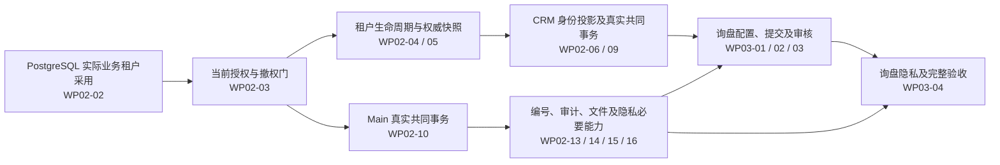

# CP6 全项目盘点与首条业务主线排期依据

盘点日期：2026-10-17；观察时间：2026-10-17T04:26:13.652224+00:00。源码和唯一台账基线：Main `4704592f52172c941e1cb95bdeb3c73f0dd179e8`（PR244）。本报告是固定时点的盘点和排期建议，后续状态继续读取 [roadmap.json](../roadmap.json)，活动 BUG 继续读取 GitHub Issues。

用户已选择“先打通一条可验收的业务主线”。本次没有重做已交付任务、启动新的业务任务或承诺全项目完成日期。

## 盘点结论

- 全范围：14 个工作包、125 个业务目标、375 张任务卡；Main 334、CRM 32、Platform 9。
- 完整任务：24 DONE、2 IN_PROGRESS、349 PLANNED。任务粒度和类型不等，24/375 不能用作项目工时完成率；PLANNED 中也存在已合并的限定交付窗口。
- 本轮完整业务目标：0/125 DONE，含义是尚未满足本轮完整设计及验收关闭条件，不表示系统没有现有代码或可复用能力。
- 125 个目标已完成固定源码差异评估：105 需要改造、20 需要新增核心用例。原验收清单 123/125 完整；ITER/REL 两个历史缺件已另有用户采纳的替代依据，不能再次要求找回原件或重复批准。
- 修订运行场景仍为 247 NOT_RUN；41 项历史静态证据仅作 REFERENCE_ONLY。13,404 是目标到验收来源的关联数（8,456 原验收、4,948 补充场景），不是全局唯一测试数或工期单位。

## 全范围工作包

“进行中”列是完整任务状态；当前四个执行窗口另见下节，不能相加作五、六个独立任务。

| 工作包 | 业务目标 | 任务卡 | DONE | IN_PROGRESS | PLANNED |
|---|---:|---:|---:|---:|---:|
| WP01 现有实现与设计对照 | 0 | 2 | 1 | 0 | 1 |
| WP02 公共平台与系统基础 | 20 | 42 | 21 | 2 | 19 |
| WP03 CRM客户经营 | 7 | 27 | 0 | 0 | 27 |
| WP04 商业交易与订单 | 8 | 37 | 0 | 0 | 37 |
| WP05 工程与产品生命周期 | 14 | 44 | 1 | 0 | 43 |
| WP06 计划计算与决策 | 7 | 13 | 0 | 0 | 13 |
| WP07 采购执行 | 7 | 15 | 0 | 0 | 15 |
| WP08 制造执行 | 7 | 18 | 0 | 0 | 18 |
| WP09 质量管理 | 4 | 12 | 0 | 0 | 12 |
| WP10 仓储与物流 | 25 | 52 | 0 | 0 | 52 |
| WP11 财务核算与结算 | 13 | 66 | 0 | 0 | 66 |
| WP12 流程与审批 | 5 | 20 | 0 | 0 | 20 |
| WP13 空间设计与运营 | 8 | 17 | 0 | 0 | 17 |
| WP14 全链集成与交付验证 | 0 | 10 | 1 | 0 | 9 |
| 合计 | 125 | 375 | 24 | 2 | 349 |

## 已交付资产与尚待采用的边界

完整 DONE 的 24 张卡为：S01-01～12 精确值/严格 JSON/原生身份与跨仓合同基础；S02-00 PostgreSQL 多租户布局设计；WP02-01/07/08/11/12/25/26/27 八项 Platform 能力；WP01-02 首批交付协调、WP05-01 ITER/REL 替代依据设计、WP14-01 全链验收映射。逐卡证据和所属仓库交付在台账中，不重新生成同一证据。

已合并、但未关闭完整任务的工作包括：Main 采用正式 Platform 0.10.3；PostgreSQL 专用连接/事务、ERP 和 Identity 的限定隔离采用、fresh-only 初始化恢复、真实服务签发与自撤销；字段权限决策；生成器安全预览；工作台数据状态；宿主身份及回退检查的部分能力。这些资产应直接复用。

剩余核心缺口是实际业务入口的采用：普通用户/部门身份与租户生命周期、当前授权与提交前撤权门、Main/CRM 真实 Owner 的共同事务及原结果、身份权威快照与 CRM 投影、必需审计/文件/隐私/编号，以及真实宿主和业务端到端验收。五表 service-token-v1 已交付不能写成全 Main 或全部租户表已启用。

## 四个新对话与 P0 调度

四份 START 均已按固定 Handoff 提交读取：

| 对话 | 当前限定任务 | START 提交 | 本次协调决定 |
|---|---|---|---|
| A | WP02-03 当前授权读取 | bf7401f9fdd6c86d650de83bcc19dfb590a6ae3a | 已复现 #245 P0，保持原独占范围优先修复 |
| B | WP02-02 租户资格 control CLI | 4c4f567b720de2fccb342a8ab11fe1e1e237db4c | 普通实施窗口暂停，向执行者发出安全停点要求 |
| C | WP02-28 实际 publish 宿主身份 | bf0df79a7b366b7b1c103a0128c930d9743b64fc | 同上，保留工作与资源，不把局部宿主验证写成上线 |
| D | WP02-18 菜单刷新恢复 / #243 | 6835a38231ef67699d21df52730b7f4dab7ce0ee | 同上，P2 排在 P0 后 |

依据 [BUG 管理规则](../../quality/BUG-MANAGEMENT.md)，P0 优先、普通开发暂停。台账登记的是协调暂停指令，尚未收到 B/C/D 的实际暂停 ACK；Handoff 发布不会自动唤醒对话，不能宣称执行者已停止。执行者读到后先安全结束在途必要操作，保留代码、失败记录、分支和端口预约，停止新增普通实施，可以继续只读准备。A 不新增授权/EF/宿主写入范围。恢复普通任务由协调窗口明确记录，不以运输 ACK 自动恢复。

三仓 Issue 查询时，CRM 和 Platform 没有打开的 Issue；Main 有以下四项。下表是本次快照，不另建 BUG 队列。

| Issue | 优先级 | 已知事实与排期影响 |
|---|---|---|
| [#245](https://github.com/GTX537/CP6/issues/245) | P0 | 主体/租户冲突及撤权后旧缓存仍允许。A 在真实消费链的定向内存基线复现 15 个失败，尚待修复和原生 PostgreSQL 验证；不能把复现环境称为生产验收。 |
| [#38](https://github.com/GTX537/CP6/issues/38) | P0 | 首次改密后旧 Cookie 阻断重新登录。Issue 仍 OPEN、无修复评论；本次源码检查仍见登录路径未豁免、改密响应未清理 Cookie。本次未做运行复现，后续需独立修复窗口与原步骤验证；DEV 验收要求不自动授权部署。 |
| [#132](https://github.com/GTX537/CP6/issues/132) | P1 | Space 大量库位查询 URL 过长；旧“查全站”补丁不满足精确范围，不能直接采用。若首个试点不消费 Space，不是 CRM 主线的直接前置，仍保留高优先级修复队列。 |
| [#243](https://github.com/GTX537/CP6/issues/243) | P2 | 菜单保存成功后读取刷新失败的恢复；D 已开工，当前按 P0 规则暂停普通实施。 |

## 首条业务主线的真实依赖

建议首个业务里程碑为“公开询盘 → 受理/审核 → 形成可跟进线索”，并以 CRM-INQ-01 的完整适用合同验收作为该目标关闭依据。可运行演示与目标关闭分开：CRM-INQ-01 主体卡 WP03-01～04 全部完成后，仍须原验收、必要修订场景及实际远端交付；同意、保留/匿名化和隐私导出不能为了演示省略。此时不自动关闭整个 CRM-LEAD、ACC、CON、OPP 目标。

按当前卡片依赖，公共前置主链为：

图只展示主要关系，准确直接前置以台账和任务卡为准。按现有完整卡口径，WP03-04 自身及其未 DONE 祖先共 15 张；WP03-03 之前有 10 张未 DONE 前置。它们已有局部交付，不能把卡数当作全新工作量；也不能跳过真实提供者而以 stub 通过。

当前依赖模型中，WP02-02 的传递后继有 348 张、WP02-03 有 347 张。这说明基础卡的收口定义会影响大部分排程；这不是工期加权关键路径，也不意味着等待整个 WP02 的 42 张卡都完成。后续应按已接受合同把剩余可消费能力明确为独立交付片段，先安排 CRM 所需部分，同时保留完整卡的最终关闭门。

## 后续排期的里程碑骨架

| 顺序 | 可验收成果 | 并行安排与边界 |
|---|---|---|
| M0 | P0 #245 修复与 #38 原步骤闭环 | A 先做 #245；#38 划定独立身份入口窗口；普通任务先暂停。需外部 DEV 验收时保留 OPEN 和准确未验证范围。 |
| M1 | 首个业务 Owner 可用的 PostgreSQL、身份授权与共同事务 | Main 租户/授权与 CRM 消费按真实版本交接；已合并的 Platform 和合同不重做。 |
| M2 | 公开询盘、受理/审核、线索入口；CRM-INQ-01 完整验收 | CRM 主体、必要 Main 审计/文件/隐私/编号、前端与真实集成分工；先定义可演示结果，再满足完整目标关闭条件。 |
| M3 | 线索 → 客户/联系人/商机的原子转换 | 先具备各真实业务 Owner 和身份关系；商业交接依赖单独接入，不能用模拟结果关闭整个 CRM。 |
| M4 | 商机 → 报价 → 订单 → 信用/需求释放 | 商业、工程最小身份和所需财务事实并行；不把全部工程/财务放到订单之后。 |
| M5 | 采购优先的收货 → 质检 → 库存 → 供给/领料 | 计划转换、采购、质量、库存按真实写入权串接；会计责任和纠错随业务同时到位。 |
| M6 | 制造执行及完整结算、纠错与恢复 | 复用 M4/M5 已交付财务与库存基础，扩展制造和剩余结算链。 |
| M7 | 其余工程、OA、SPACE 专项与发布准备 | 首条业务链实际需要的 OA/SPACE 提前交付；其余按试点范围排序。发布权威/Registry 决策及正式环境门禁独立。 |

这些是排程顺序建议，没有新增实施准入。当前四窗口的稳定停点/交付接收后，再将四个执行队列逐步调整为：A Main 身份/授权与公共基础；B CRM 真实事务及询盘主体；C Main 业务支撑和后续商业/工程依赖；D 前端与主线集成。队列名称不授予整个领域的并发写权；公共模型、配置和事务入口仍由协调安排独占窗口，逐任务串行合并。

## 日程还缺什么

台账只有 S/M/L 相对规模（1/189/185），工作包估算置信度均 LOW，没有按剩余范围校准的人日/有效执行时长。四个聊天不等于四倍吞吐；跨仓采用、共享文件和集中合并是实际约束。现在无法从 375 或 13 轮推导可靠上线日期。

下一步排日历时，先给 M0～M2 的剩余交付片段确定：明确完成条件、唯一执行者、可并行文件范围、依赖交付物、预计执行区间及验证/集成预留；其余里程碑先给粗范围，按前两次真实交付校准。采用滚动计划：近期 1～2 周细到任务窗口，远期保持里程碑，不把未知时长伪装成固定日期。

需要同步修正的计划表达：早期 [04-batches](../04-batches.md) / [06-first-slices](../06-first-slices.md) 保留初始“尚未开工/全部 PLANNED”快照，不能覆盖当前台账；后续正式日程应清楚标注其历史性。长期大卡 WP02-02/03/10 等需要列出剩余闭环片段和消费边界，避免持续局部交付却没有清晰收口。ITER/REL 替代依据已获采纳，独立技术信任配置的缺口按实际采用阶段处理，不能阻塞无关的 123 个目标。

## 本次验证范围

本次只读盘点台账、任务卡、已有交付、当前源码和三仓 Issues，读取四份 START 与 #245 固定 Handoff。对本次文档/调度变更检查完整 diff、必要本地链接和台账生成一致性；不执行产品编译或业务测试，不重复原交付验证。执行者本轮未交付的代码不在本次审查范围。无 Actions 触发或取消、无工作流变化、无发包、既有数据库操作或部署。
